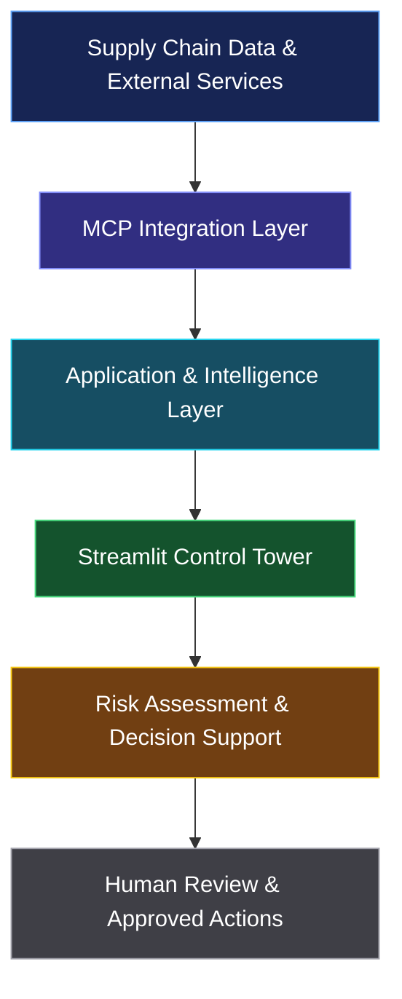

# MCP Powered Supply Chain Risk Intelligence & Decision Support System

<p align="center">
  <strong>From fragmented supply chain data to informed operational decisions.</strong>
</p>

<p align="center">
  <em>An intelligent, MCP-integrated control tower for supply chain visibility, risk assessment, disruption awareness, and human-guided decision support.</em>
</p>

<p align="center">
  
  
  
  
  
</p>

---

## Overview

Modern supply chains operate across interconnected functions, external service providers, and constantly changing operational conditions. Yet, information is often fragmented across inventory records, supplier systems, shipment updates, production schedules, and external data sources.

This fragmentation makes it difficult to identify emerging risks, understand their operational consequences, and respond before disruptions escalate.

The **MCP-Integrated Supply Chain Risk Intelligence & Decision Support System** addresses this challenge through a unified monitoring and decision-support environment.

Built around **Model Context Protocol (MCP)** integrations, an orchestrated intelligence layer, and an interactive Streamlit control tower, the platform brings relevant operational information into a consolidated environment. It helps identify potential disruptions, assess their implications, and translate complex operational signals into clear, actionable recommendations.

The objective is not simply to display supply chain data, but to make that data more meaningful for decision-making.

## The Problem

Supply chain decisions become increasingly difficult when critical information is distributed across disconnected systems.

Key challenges include:

- **Limited visibility:** Operational information is scattered across multiple sources.
- **Delayed risk identification:** Shortages, supplier delays, and shipment disruptions may not be recognized early enough.
- **Disconnected dependencies:** The relationship between inventory availability, inbound deliveries, and production requirements is not always immediately apparent.
- **Unclear operational impact:** Identifying an issue does not automatically explain its consequences.
- **Reactive decision-making:** Teams often respond to disruptions after they have already affected operations.

A consolidated approach is required—one that connects information, interprets operational conditions, and supports informed intervention.

## The Solution

The platform functions as an integrated supply chain intelligence and decision-support environment.

It brings together operational data, analytical capabilities, MCP-enabled integrations, and conversational intelligence to provide:

- Centralized operational visibility.
- Inventory and material shortage monitoring.
- Supplier performance and delivery-risk assessment.
- Shipment status and disruption awareness.
- Production dependency and potential impact analysis.
- Procurement-related decision support.
- Consolidated risk indicators and operational analytics.
- Context-aware recommendations for preventive action.

The result is a more connected view of supply chain operations, helping users move from identifying an issue to understanding its significance and evaluating possible responses.

## Core Capabilities

| Capability | Description |
|---|---|
| Executive Control Tower | Consolidated view of operational health, key indicators, and priority concerns. |
| Conversational Intelligence | Natural-language interaction for supply chain questions and operational investigations. |
| Inventory Intelligence | Visibility into stock availability, material exposure, and potential shortages. |
| Supplier Intelligence | Supplier information, performance indicators, and delivery-related risks. |
| Shipment Monitoring | Shipment visibility, delivery status, and potential delays. |
| Production Impact Analysis | Assessment of how material availability and inbound deliveries may affect production requirements. |
| Procurement Decision Support | Contextual insights to support sourcing and replenishment decisions. |
| Risk Centre | Centralized visibility into identified risks and operational alerts. |
| Analytics | Operational metrics, trends, and decision-oriented insights. |
| Integration Monitoring | Visibility into the availability and operating state of connected services. |

## MCP Integration & Intelligence Architecture

Model Context Protocol (MCP) provides the integration foundation through which the application can interact with distinct operational services.

Rather than treating every external source as an isolated information channel, the platform uses an MCP-enabled integration layer to make relevant information and capabilities accessible to its application and intelligence components.

The overall architecture can be understood through the following high-level representation:



### Integration Ecosystem

The platform is designed to work with a combination of operational and external information sources:

| Integration | Purpose |
|---|---|
| Operational Database | Structured supply chain records and application data. |
| Google Sheets | External spreadsheet-based operational information. |
| Logistics API | Shipment and delivery-related information. |
| Weather Service | External environmental conditions relevant to logistics awareness. |
| Slack | Communication and notification capabilities. |
| MCP Services | Standardized access to connected data and service capabilities. |

The availability of live information depends on the configuration and connectivity of the respective services. The platform also supports a demonstration environment for evaluation without requiring every external integration.

## Intelligence & Decision Support

The intelligence layer combines operational context, analytical results, and conversational interaction.

Users can investigate questions such as:

- Which materials may be at risk of shortage?
- What operational consequences could follow a delayed delivery?
- Which suppliers present greater delivery-related concerns?
- How might an inventory constraint affect upcoming production?
- What actions could help mitigate an identified disruption?

Instead of presenting isolated metrics, the system aims to connect relevant information and explain its operational significance.

Recommendations are intended to support human judgement—not replace it.

## Human-in-the-Loop Governance

Operational intelligence is most valuable when accompanied by appropriate control and accountability.

The platform incorporates a human-review approach for supported external actions.

Key principles include:

- Human approval before supported write operations.
- Role-aware approval controls.
- Validation of proposed actions.
- Audit history for recorded actions.
- Explicit reporting of successful and unsuccessful operations.
- Separation between demonstration data and connected live services.

The system does not treat a recommendation as an executed action. External operations are subject to their configured approval and service-response requirements.

## Technology Stack

| Layer | Technologies |
|---|---|
| Programming Language | Python |
| Frontend & Dashboard | Streamlit |
| Data Visualization | Plotly |
| Integration Standard | Model Context Protocol (MCP) |
| MCP Runtime | FastMCP |
| Agent Orchestration | LangGraph |
| LLM Connectivity | Groq / Ollama (optional) |
| Data Processing | Pandas |
| Database & ORM | SQLite, PostgreSQL / Supabase, SQLAlchemy |
| External Integrations | Google Sheets, Slack, Logistics API, Open-Meteo |
| Deployment Support | Streamlit Community Cloud, Docker |

## Application Interface

The Streamlit application is organized into dedicated operational workspaces:

| Workspace | Focus |
|---|---|
| Overview | Executive-level supply chain visibility |
| AI Agent | Conversational investigation and assistance |
| Inventory | Stock levels and material availability |
| Suppliers | Supplier information and performance |
| Shipments | Logistics and delivery monitoring |
| Production | Production requirements and material dependencies |
| Procurement | Procurement intelligence and decision support |
| Risk Centre | Risk visibility and operational alerts |
| Analytics | Metrics and analytical insights |
| Integrations | Connected-service monitoring |
| Settings | Application configuration and controls |

The interface is designed around a centralized control-tower experience, with a consistent visual hierarchy, analytical components, and accessible navigation.

## Data Integrity & Operational Transparency

A decision-support platform must distinguish between verified information, estimates, and unavailable data.

The system is designed with explicit operational states:

- **Live:** A connected service has successfully provided information.
- **Demo:** Demonstration information is being used and is identified accordingly.
- **Disconnected:** A service is unavailable or has not been successfully connected.

Additional design considerations include:

- Operational figures are grounded in available application or service results.
- Estimates and forecasts should not be presented as confirmed facts.
- Missing information should not be silently replaced with invented values.
- Failed external actions should not be reported as successful.
- Connected-service status is surfaced through the application.

These principles support greater transparency and more responsible operational decision-making.

## Getting Started

### 1. Clone the repository

```bash
git clone https://github.com/armaans-29/MCP-Integrated-Supply-Chain-Risk-Intelligence-Decision-Support-System.git

cd MCP-Integrated-Supply-Chain-Risk-Intelligence-Decision-Support-System
```

### 2. Create a virtual environment

**Windows (PowerShell)**

```powershell
python -m venv .venv
.venv\Scripts\Activate.ps1
```

**macOS / Linux**

```bash
python -m venv .venv
source .venv/bin/activate
```

### 3. Install dependencies

```bash
pip install -r requirements.txt
```

### 4. Configure integrations

The application supports a local demonstration configuration and optional external integrations.

Configure the required connection settings and credentials through your local environment or deployment secrets.

Do not commit API keys, service-account credentials, database passwords, or private configuration files to the repository.

### 5. Launch the application

```bash
streamlit run app.py
```

The application will start in your local environment and provide access to the Streamlit interface.

## Deployment

The application is structured for deployment through Streamlit Community Cloud or a compatible Python hosting environment.

For deployment:

1. Connect the GitHub repository to your hosting platform.
2. Select `app.py` as the application entry point.
3. Install dependencies from `requirements.txt`.
4. Configure the required secrets through the hosting platform.
5. Ensure any external MCP services and integrations are reachable from the deployment environment.

For container-based execution, the repository also includes Docker-related configuration.

**Deployment note:** Live integrations require valid credentials, accessible services, and appropriate network configuration. A successful dashboard launch alone does not establish that every external integration is operational.

## Project Scope

This project is developed as a functional MVP demonstrating how MCP-based connectivity, operational analytics, agent orchestration, and human-guided decision support can work together in a supply chain environment.

It is intended to demonstrate an extensible architectural approach rather than claim a fully deployed enterprise supply chain management system.

Its emphasis is on operational visibility, contextual risk awareness, integration-driven intelligence, and accountable decision support.

## Future Scope

Potential areas for further development include:

- Expanded ERP and enterprise-system connectivity.
- More advanced demand and disruption forecasting.
- Enhanced supplier-risk intelligence.
- Richer scenario analysis and impact simulation.
- Extended role-based access and authentication.
- Broader operational reporting and analytics.
- Scalable deployment of distributed MCP services.

## Closing Perspective

Supply chain resilience depends not only on access to information, but also on the ability to interpret it, understand its consequences, and respond appropriately.

This project explores that principle through an integrated architecture connecting operational data, MCP-based services, analytical intelligence, and human decision-making.

**The objective: greater visibility, earlier risk awareness, and more informed supply chain decisions.**
