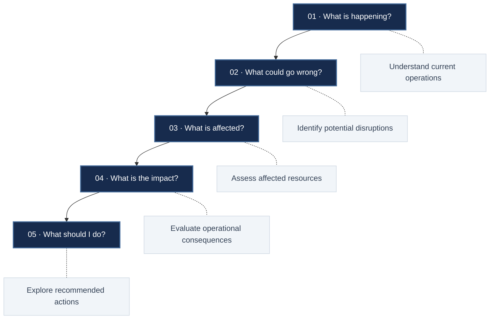
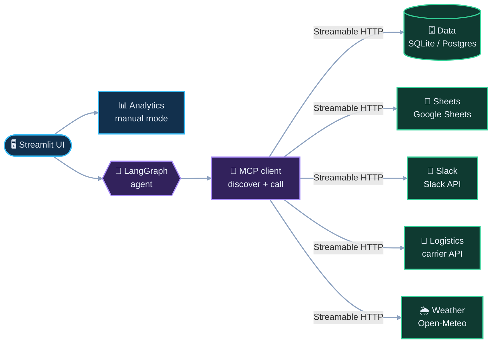
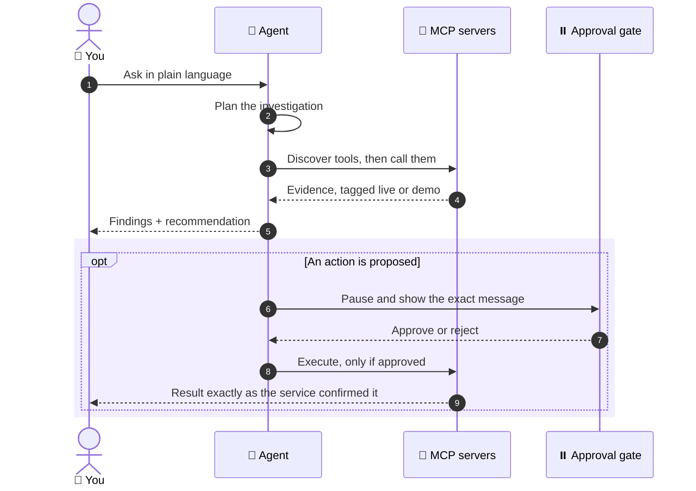
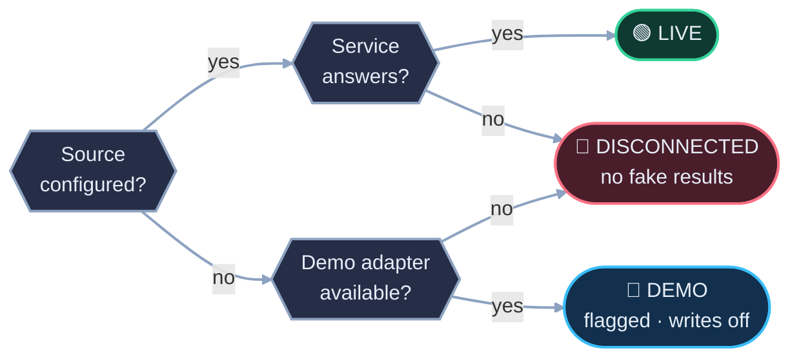

<div align="center">

# MCP Powered Supply Chain Critical Decision Support System

**An agent that reads your supply chain, finds trouble early, and asks before it acts.**


[](https://mcp-supply-chain-real-time-risk-idea.streamlit.app/)


##  Pick the path


| **Skimming** | **Engineering** | **Operations** |
|:---|:---|:---|
| [The Pitch](#-the-pitch) | [Under the Hood](#-under-the-hood) | [The Problem](#-the-problem-in-one-afternoon) |
| [Five Questions](#-five-questions-one-answer) | [Architecture](#-architecture) | [Five Questions](#-five-questions-one-answer) |
| [Product Tour](#-product-tour) | [How an Investigation Runs](#-how-an-investigation-runs) | [Data & Live-ness](#-data--live-ness) |
| [Quick Start](#-quick-start) | [Tests](#-tests) | [Product Tour](#-product-tour) |


</div>
<br>

## ✨ The pitch

> Your inventory, suppliers, shipments and production orders live in different places. **Sentinel connects them through MCP**, lets an agent investigate across all of them, and hands you the finding, the evidence and a recommendation. Anything that touches the outside world waits for your approval.

It is not a chatbot bolted onto a dashboard. The dashboard and the agent share one set of calculations, so they never disagree.

<br>

## 🌧️ The problem, in one noon

A supplier e-mail lands: *the resin shipment is running late.*

Now someone has to open the inventory sheet, find the purchase order, check the carrier portal, look up which production orders need that resin, and guess what it all adds up to. Every one of those is a different tab, owned by a different person.

By the time the picture is clear, the decision is late. Late decisions are how stockouts, rush freight and idle production lines happen.

**Sentinel does that cross-checking for you.** An illustrative exchange:

```text
you      ▸ A supplier has delayed my raw material delivery. What will happen?

sentinel ▸ Checking purchase orders, stock cover and open production orders…
           ✔ data   ✔ logistics   ✔ weather

           FACT      The inbound shipment is behind its original ETA.
           ESTIMATE  Stock may run out before the new arrival date.
           ESTIMATE  Some open production orders could slip past their due dates.
           OPTIONS   Expedite · re-sequence orders · ship a partial batch.

           ⏸  A Slack note to procurement is drafted. Waiting for your approval.
```

<br>


## 🎯 Five questions, one answer



<br>

Every investigation resolves into these five. Facts, estimates and recommendations stay visibly separate, and each answer lists which systems it touched.

<br>

## 🖼️ Product tour

<table>
  <tr>
    <td width="50%" valign="top">
      <br>
      <sub><b>Control Tower</b> · what needs attention first</sub>
    </td>
    <td width="50%" valign="top">
      <br>
      <sub><b>AI Investigation Centre</b> · ask, inspect the evidence, approve</sub>
    </td>
  </tr>
  <tr>
    <td width="50%" valign="top">
      <br>
      <sub><b>Inventory</b> · how long stock lasts versus when help arrives</sub>
    </td>
    <td width="50%" valign="top">
      <br>
      <sub><b>Integrations</b> · the real status of every service</sub>
    </td>
  </tr>
</table>

<br>

## 🔩 Under the hood

<table>
  <tr>
    <td width="33%" valign="top">
      <h4>🔌 Five MCP servers</h4>
      Data, Sheets, Slack, logistics and weather. Each is its own server over Streamable HTTP.<br><br>
      <sub>💡 <b>Why it matters:</b> swap or secure one integration without touching the rest.</sub>
    </td>
    <td width="33%" valign="top">
      <h4>🔎 Tool discovery</h4>
      The client asks the servers what tools exist at runtime instead of hard-coding them.<br><br>
      <sub>💡 <b>Why it matters:</b> new capabilities appear without agent changes.</sub>
    </td>
    <td width="33%" valign="top">
      <h4>⏸️ Approval gate</h4>
      A LangGraph workflow pauses before any external action and waits for a human decision.<br><br>
      <sub>💡 <b>Why it matters:</b> nothing consequential happens on its own.</sub>
    </td>
  </tr>
  <tr>
    <td width="33%" valign="top">
      <h4>🚦 Honest modes</h4>
      Every service reports <code>live</code>, <code>demo</code> or <code>disconnected</code>, measured at runtime.<br><br>
      <sub>💡 <b>Why it matters:</b> you always know what you are looking at.</sub>
    </td>
    <td width="33%" valign="top">
      <h4>🚫 No invented results</h4>
      A failed call is shown as failed. Sample data is always flagged. Every number comes from a tool result.<br><br>
      <sub>💡 <b>Why it matters:</b> trust survives the bad day.</sub>
    </td>
    <td width="33%" valign="top">
      <h4>🧾 Audited writes</h4>
      Write tools re-check the approval and the exact payload server-side, and every action is logged.<br><br>
      <sub>💡 <b>Why it matters:</b> a clear trail of who approved what.</sub>
    </td>
  </tr>
</table>

<details>
<summary><b>More on the safety model</b></summary>

<br>

- Write tools accept only an approved action from a sufficiently privileged role, and only if the payload matches what was approved.
- There is no raw-SQL tool, and writes are validated before they reach the database.
- Secrets live in environment variables only.
- An action counts as done only when the target service confirms it. Slack, for example, must acknowledge the message.
- An optional LLM can help with wording. It does not supply figures.

</details>

<br>

## 🏗️ Architecture

> 🔍 *On GitHub you can click any diagram to zoom and pan.*

<details open>
<summary><b>System at a glance</b></summary>



</details>

Manual mode and agent mode run on the same analytics, so a dashboard figure and an agent answer always agree.

| Server | Role | Can write? |
|:--|:--|:--:|
| 🗄️ **Data** | Inventory, suppliers, orders, production, KPIs, risk alerts | 🔐 gated |
| 📄 **Sheets** | Inventory, suppliers and purchase orders from Google Sheets | 🔐 gated |
| 💬 **Slack** | Team notifications | 🔐 gated |
| 🚢 **Logistics** | Shipment status, ETAs and events | read-only |
| 🌦️ **Weather** | Forecasts and route-risk signals | read-only |

26 tools in total, discovered dynamically. 🔐 means the write tool needs an approved action.

<br>

## 🔬 How an investigation runs

<details open>
<summary><b>From question to approved action</b></summary>



</details>

Things worth trying in the **🤖 AI Agent** page:

- *Which materials are at risk of running out this week?*
- *A supplier has delayed my raw material delivery. What will happen?*
- *Which supplier should I choose for polymer resin?*
- *Notify my procurement team about critical shortages.*

<br>


## 🌍 Data & live-ness

<div align="center">
  
</div>

<br>

Each source reports its own mode.

| Source | What it provides | Status | How it behaves |
|:--|:--|:--:|:--|
| 🗄️ **Database** | Inventory, suppliers, orders, production, alerts, audit log | 🔵 Demo<br>🟢 Live with `DATABASE_URL` | A seeded SQLite demo dataset by default. Switches to your Supabase/PostgreSQL when configured. |
| 📄 **Google Sheets** | Inventory, suppliers, purchase orders | 🔵 Demo<br>🔑 Needs credentials for live | Read-only demo data without credentials. Live read and write once a service account and sheet are set up. |
| 💬 **Slack** | Team notifications | 🔴 Disconnected<br>🔑 Needs credentials | Without a bot token it is disconnected. Messages go out only after approval, and success is reported only when Slack confirms. |
| 🚢 **Logistics / shipments** | Status, ETAs, events, locations | 🔵 Demo<br>🟢 Live with `LOGISTICS_API_URL` | Seeded sample shipments unless a logistics API URL is configured, then live. |
| 🌦️ **Weather** | Forecasts and route-risk signals | 🟢 Live when online | Uses Open-Meteo, no key needed. An offline synthetic mode exists and is clearly flagged. |

<details open>
<summary><b>How a source gets its mode</b></summary>



</details>

"Real-time" describes what the pipeline supports once live sources are connected. The hosted demo runs on the seeded SQLite dataset with sample shipments and demo-mode Sheets. Slack is disconnected there, so nothing can be sent, and weather comes from Open-Meteo whenever it is reachable.

The **Integrations** page runs live checks and shows the true mode of every service.

<br>

## 🚀 Quick start

Two minutes, no keys needed.

```bash
python -m venv .venv && source .venv/bin/activate      # Windows: .venv\Scripts\activate
pip install -r requirements.txt
cp .env.example .env                                   # optional: demo mode works without edits
streamlit run app.py                                   # opens http://localhost:8501
```

The app builds the demo database and starts the five MCP servers on its own.

<details>
<summary><b>🧩 Run the servers as separate processes</b></summary>

<br>

```bash
python run_servers.py        # terminal 1: all five MCP servers
streamlit run app.py         # terminal 2: the UI
```

</details>

<details>
<summary><b>🐳 Docker</b></summary>

<br>

```bash
cp .env.example .env
docker compose up --build
```

The compose file mounts `./data` for the database and expects `service_account.json` in the project root (needed only for Google Sheets). An optional read-only REST API runs with `docker compose --profile api up`.

</details>

<br>

## 🔌 Plug in real services

Everything is optional. Add what you have, restart, then open the **Integrations** page to confirm.

<details>
<summary><b>🗄️ Supabase / PostgreSQL</b></summary>

<br>

Set `DATABASE_URL=postgresql+psycopg2://…` (Supabase: Project → Database → connection URI). Tables and demo data are created on first start, or run `sentinel/schema.sql` yourself.

</details>

<details>
<summary><b>📄 Google Sheets</b></summary>

<br>

1. Create a service account and point `GOOGLE_SERVICE_ACCOUNT_FILE` at its JSON file.
2. Share your spreadsheet with the service account's e-mail and set `GOOGLE_SHEET_ID`.
3. To push a starter template: `python scripts/seed_google_sheet.py`

</details>

<details>
<summary><b>💬 Slack</b></summary>

<br>

Create an app with the `chat:write` scope, set `SLACK_BOT_TOKEN`, invite the bot to your channel, and set `SLACK_DEFAULT_CHANNEL`.

</details>

<details>
<summary><b>🚢 Logistics API</b></summary>

<br>

Set `LOGISTICS_API_URL` (and optionally `LOGISTICS_API_KEY`, sent as a Bearer token). Shipments are matched to your purchase orders by tracking number. The adapter expects `GET {LOGISTICS_API_URL}/shipments` to return:

```json
{
  "shipments": [
    {
      "tracking_number": "…",
      "status": "…",
      "eta": "…",
      "last_event": "…",
      "location": "…",
      "lat": 0.0,
      "lon": 0.0
    }
  ]
}
```

</details>

<details>
<summary><b>🌦️ Weather &nbsp;·&nbsp; 🧠 LLM</b></summary>

<br>

- **Weather** works out of the box through Open-Meteo. Set `WEATHER_MODE=demo` to run fully offline.
- **LLM** is optional. Set `GROQ_API_KEY`, or `OLLAMA_MODEL` plus `pip install langchain-ollama`. Without one, the agent runs on its rule-based planner.

</details>

> [!TIP]
> Keep `.env` and `service_account.json` out of version control. Both are already in `.gitignore`.

<br>

## 📊 KPIs

Every KPI is calculated from stored records and labelled **actual**, **estimate** or **forecast**. A KPI without the data it needs shows *n/a* and says why.

<details>
<summary><b>See the full list</b></summary>

<br>

| | KPI | In one line |
|:-:|:--|:--|
| 📦 | Inventory turnover | How quickly stock is consumed and replaced |
| 📦 | Days of inventory on hand | How long current stock lasts at recent demand |
| 📦 | Stock-out risk | Whether stock may run out before the next delivery |
| 📦 | Reorder point | The stock level at which to reorder |
| 📦 | Excess / slow-moving inventory | Stock well beyond, or barely touched by, demand |
| 🏭 | Supplier on-time delivery | Share of received orders that arrived on time |
| 🏭 | Average lead time | Typical days from order to receipt |
| 🏭 | Lead-time variability | How predictable a supplier's lead time is |
| 🏭 | Order fulfilment rate · OTIF | Orders received in full, and in full and on time |
| 🧾 | Procurement cost variance | Price paid compared with standard cost |
| 🚢 | Shipment delay rate | Share of shipments later than first promised |
| ⚙️ | Production schedule adherence | How closely completed orders met their due dates |
| ✅ | Perfect order rate · inventory accuracy | *n/a* unless the underlying data exists |

</details>

Supplier reliability is a weighted score, and stock risk is judged by comparing stock cover against inbound arrival. Both are decision aids built from order history, not guarantees.

<br>

## 🧪 Tests

```bash
pytest -q
```

The suite starts the MCP servers on test ports and covers tool discovery, tool calls, approval enforcement, honest failure handling, the agent workflows and the human-approval flow.

<br>

## 🗂️ Project structure

<details>
<summary><b>Open the map</b></summary>

```text
app.py               Streamlit control tower (11 pages)
run_servers.py       Run the MCP servers as standalone processes
sentinel/
  agent.py           LangGraph agent with the approval gate
  mcp_client.py      MCP client: discovery, calls, health checks
  analytics.py       Shared calculations for manual and agent modes
  db.py  seed.py     Persistence and demo dataset
  launcher.py        Starts and checks the MCP servers
  api.py             Optional read-only REST API
  servers/           The five MCP servers
tests/               MCP, agent and approval tests
scripts/             Helper scripts (e.g. Google Sheets template)
docs/images/         README artwork and screenshots
Dockerfile  docker-compose.yml  requirements.txt  .env.example
```

</details>

<br>

## 🗺️ Roadmap

| Next | Soon | Later |
|:--|:--|:--|
| 🔑 Built-in authentication, with real users mapped to roles | 🔒 Token authentication in front of the MCP servers | ☁️ A documented cloud deployment path |
| 🔔 Scheduled risk scans with proactive alerts | 📈 Richer forecasting where history allows | 🔗 More logistics adapters |

<br>

## 🤝 Honest limitations

> [!NOTE]
> Good tools say what they can't do.

- **Demo by default.** Out of the box the data is a seeded sample. Connect your own sources to work with real operations.
- **Decision aids, not oracles.** Scores and risk levels come from order history, and impact estimates assume current ETAs hold.
- **The role selector is a demo control.** Write permissions are enforced server-side, but mapping real users to roles needs your identity provider.
- **Localhost first.** Put the MCP servers on an internal network, behind authentication, before exposing them beyond your machine.
- **Narrow write surface.** Writes are limited to approved Slack messages and inventory-record updates. The agent never creates purchase orders or moves money.
- **Fixed logistics shape.** The logistics adapter expects the response format shown above.
- **Lightweight forecasting.** Forecasts are statistical projections, labelled as such, never confirmed demand.
- **Single-process UI.** Streamlit here is built for demonstration and evaluation, not high concurrency.

<br>

<div align="center">


<sub>Built to stay calm under pressure, and honest about what it knows.</sub>

</div>
