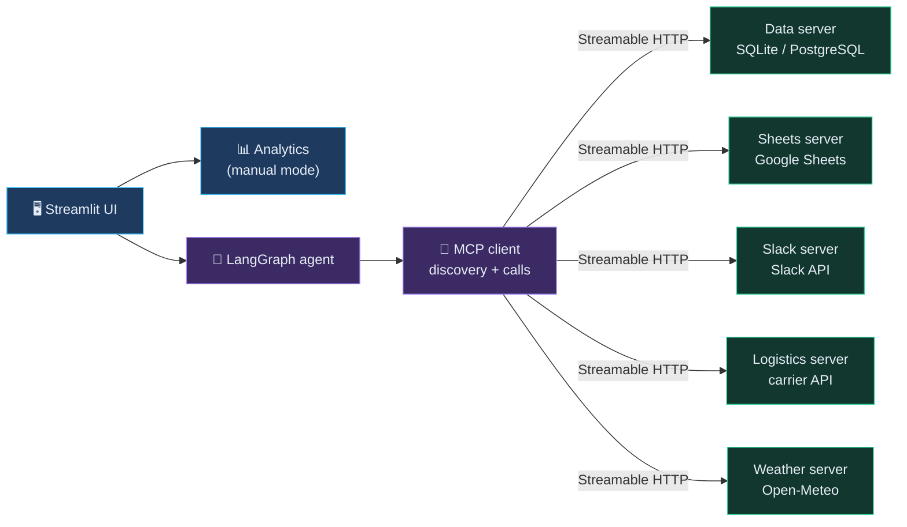
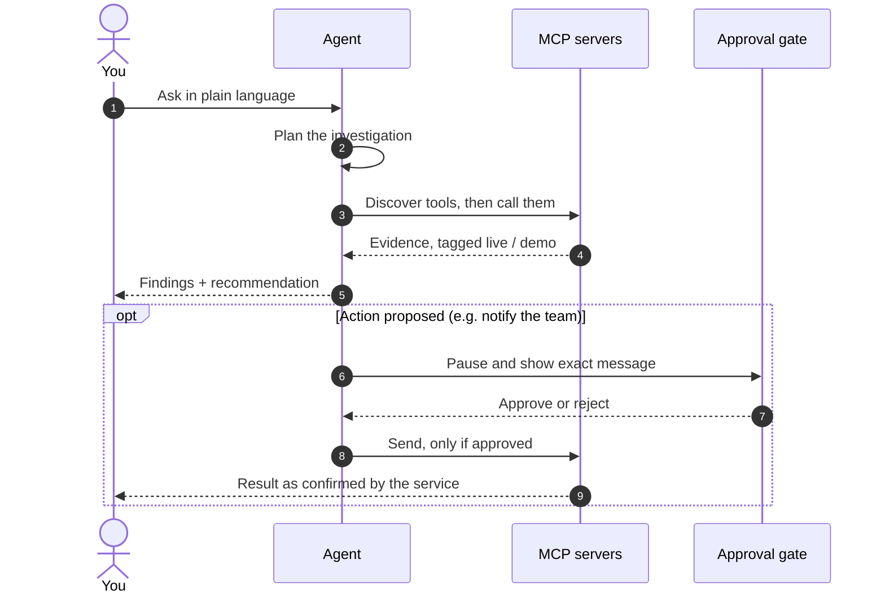
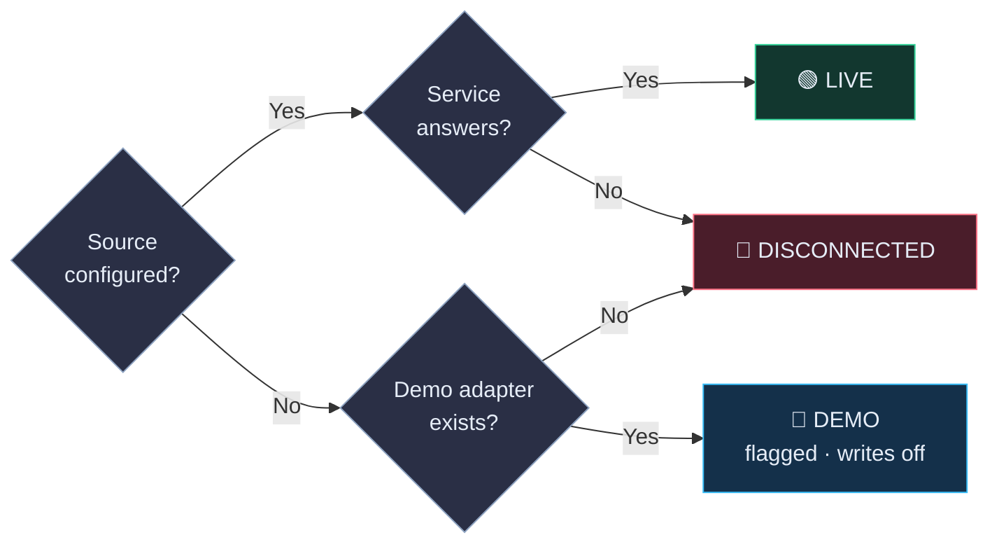

<div align="center">

# 🛰️ SupplyChain Sentinel AI

**Spot supply-chain trouble before it becomes expensive.**
*One control tower. Five MCP servers. An agent that investigates, and asks before it acts.*

<br>


<br>

### ▶ [Open the live demo](https://mcp-supply-chain-real-time-risk-idea.streamlit.app/)

</div>


---

## 📑 Contents

[The problem](#-the-problem) · [What it answers](#-what-it-answers) · [Engineering highlights](#-engineering-highlights) · [Architecture](#-architecture) · [How an investigation runs](#-how-an-investigation-runs) · [Data & live-ness](#-data--live-ness) · [Quick start](#-quick-start-2-minutes) · [Integration setup](#-integration-setup) · [KPIs](#-kpis) · [Testing](#-testing) · [Project structure](#-project-structure) · [Roadmap](#-roadmap) · [Limitations](#-honest-limitations)

---

## 🌫️ The problem

Inventory sits in one system. Suppliers in another. Shipments in a carrier portal, production orders in a third tool.

When a delivery slips, someone has to open all of them, line up the numbers by hand, and work out what it means. By then the decision is late, and late decisions turn into stockouts, rush freight and idle production lines.

Sentinel connects those systems through MCP and lets an agent do the cross-checking, with the evidence attached.

## 🧭 What it answers

Every investigation comes back to five questions:

| | Question | What you get |
|---|---|---|
| 1 | **What is happening?** | Current stock, open orders, shipments in motion |
| 2 | **What could go wrong?** | Early risk flags with severity and an explanation |
| 3 | **What is affected?** | The materials, suppliers, shipments and production orders involved |
| 4 | **What is the impact?** | Estimated value and schedule exposure, labelled as an estimate |
| 5 | **What should I do?** | Evidence-backed recommendations; external actions wait for your approval |

> **Why it matters:** an operations manager gets the answer and the reasoning in one place, instead of five tabs.

---

## ⚙️ Engineering highlights

| Capability | What it does | Why it matters |
|---|---|---|
| 🔌 **Five independent MCP servers** | Data, Sheets, Slack, logistics and weather each run as their own server over Streamable HTTP | Each integration can be tested, replaced or secured on its own |
| 🔎 **Dynamic tool discovery** | The client asks the servers what tools exist, rather than hard-coding them | New tools appear without changing the agent |
| ⏸️ **Human-in-the-loop agent** | A LangGraph workflow pauses at an approval gate before any external action | Nothing consequential happens without a person saying yes |
| 🚦 **Honest modes** | Every service reports `live`, `demo` or `disconnected`, measured at runtime | You always know what you are looking at |
| 🚫 **No fabricated results** | Failed calls surface as failures; sample data is always flagged | Trust survives the bad day |
| 🧾 **Audited writes** | Approved actions are recorded; write tools re-verify the approval server-side | A clear trail of who approved what |

<details>
<summary><b>More on the safety model</b></summary>

- Write tools accept only an approved action from a sufficiently privileged role, and the server checks that the payload matches what was approved.
- There is no raw-SQL tool. Writes are validated before they reach the database.
- Secrets live in environment variables only.
- An action is reported as done only when the target service confirms it. A Slack message, for instance, needs an explicit acknowledgement from Slack.
- Numbers in an answer come from tool results. An optional LLM can help with wording, not with figures.

</details>

---

## 🏗️ Architecture

> 💡 *On GitHub, click a diagram to zoom and pan.*

<details open>
<summary><b>System overview</b></summary>



</details>

Manual mode and agent mode share the same analytics, so a number on a dashboard and a number in an answer agree.

<div align="center">
  
</div>

---

## 🔬 How an investigation runs

<details open>
<summary><b>From question to approved action</b></summary>



</details>

Try these in the **🤖 AI Agent** page:

- *Which materials are at risk of running out this week?*
- *A supplier has delayed my raw material delivery. What will happen?*
- *Which supplier should I choose for polymer resin?*
- *Notify my procurement team about critical shortages.*

> **Why it matters:** facts, estimates and recommendations stay visibly separate, and every answer shows which systems it touched.

---

## 🌍 Data & live-ness

Each source is its own MCP server, and each reports its own mode.

<details open>
<summary><b>Source by source</b></summary>

| Source | What it provides | Status | How it behaves |
|---|---|---|---|
| 🗄️ **Database** | Inventory, suppliers, purchase orders, production orders, alerts, audit log | **Demo** · **Live** with `DATABASE_URL` | A seeded SQLite demo dataset by default; switches to your Supabase/PostgreSQL when configured. |
| 📄 **Google Sheets** | Inventory, suppliers, purchase orders | **Demo** · **Needs credentials** for live | Read-only demo data without credentials; live read/write once a service account and sheet are set up. |
| 💬 **Slack** | Team notifications | **Needs credentials** | Disconnected without a bot token; sends only after approval, and reports success only when Slack confirms. |
| 🚢 **Logistics / shipments** | Shipment status, ETAs, events, locations | **Demo** · **Live** with `LOGISTICS_API_URL` | Seeded sample shipments unless a logistics API URL is configured, then live. |
| 🌦️ **Weather** | Forecasts and route-risk signals | **Live** when online | Uses Open-Meteo, no key needed. An offline synthetic mode exists and is clearly flagged. |

</details>

<details open>
<summary><b>How a source gets its mode</b></summary>



</details>

"Real-time" describes what the pipeline supports once live sources are connected. The hosted demo runs on the seeded SQLite dataset with sample shipments and demo-mode Sheets; Slack is disconnected there, so no messages can be sent, and weather comes from Open-Meteo whenever it is reachable.

The **Integrations** page runs live checks and shows the real mode of every service.

---

## 🚀 Quick start (2 minutes)

No keys needed.

```bash
python -m venv .venv && source .venv/bin/activate      # Windows: .venv\Scripts\activate
pip install -r requirements.txt
cp .env.example .env                                   # optional: demo mode works without edits
streamlit run app.py                                   # opens http://localhost:8501
```

The app creates the demo database and starts the five MCP servers itself.

<details>
<summary><b>Run the servers as separate processes</b></summary>

```bash
python run_servers.py        # terminal 1: starts all five MCP servers
streamlit run app.py         # terminal 2
```

</details>

<details>
<summary><b>Docker</b></summary>

```bash
cp .env.example .env
docker compose up --build
```

The compose file mounts `./data` for the database and expects `service_account.json` in the project root (only used for Google Sheets). An optional read-only REST API is available with `docker compose --profile api up`.

</details>

---

## 🔧 Integration setup

Everything is optional. Add what you have, restart the app, and check the **Integrations** page.

| Service | What to do |
|---|---|
| **Supabase / PostgreSQL** | Set `DATABASE_URL=postgresql+psycopg2://…` (Supabase: Project → Database → connection URI). Tables and demo data are created on first start, or run `sentinel/schema.sql`. |
| **Google Sheets** | Create a service account and point `GOOGLE_SERVICE_ACCOUNT_FILE` at its JSON. Share your sheet with the account's e-mail and set `GOOGLE_SHEET_ID`. To push a starter template: `python scripts/seed_google_sheet.py`. |
| **Slack** | Create an app with the `chat:write` scope, set `SLACK_BOT_TOKEN`, invite the bot to the channel and set `SLACK_DEFAULT_CHANNEL`. |
| **Logistics API** | Set `LOGISTICS_API_URL` (and optionally `LOGISTICS_API_KEY`, sent as a Bearer token). Shipments are matched to your purchase orders by tracking number. |
| **Weather** | Works out of the box via Open-Meteo. Set `WEATHER_MODE=demo` to run fully offline. |
| **LLM (optional)** | Set `GROQ_API_KEY`, or `OLLAMA_MODEL` plus `pip install langchain-ollama`. Without one, the agent runs on its rule-based planner. |

<details>
<summary><b>Logistics API response shape</b></summary>

The adapter expects `GET {LOGISTICS_API_URL}/shipments` to return:

```json
{
  "shipments": [
    {
      "tracking_number": "…",
      "status": "…",
      "eta": "…",
      "last_event": "…",
      "location": "…",
      "lat": 0.0,
      "lon": 0.0
    }
  ]
}
```

</details>

> 🔐 Keep `.env` and `service_account.json` out of version control. Both are already in `.gitignore`.

---

## 📊 KPIs

All KPIs are calculated from stored records and labelled **actual**, **estimate** or **forecast**. A KPI without the data it needs shows *n/a* and says why, rather than a made-up number.

<details>
<summary><b>KPI list</b></summary>

| KPI | What it tells you |
|---|---|
| Inventory turnover | How quickly stock is consumed and replaced |
| Days of inventory on hand | How long current stock lasts at recent demand |
| Stock-out risk | Whether stock is likely to run out before the next delivery |
| Reorder point | The stock level at which to reorder |
| Supplier on-time delivery | Share of received orders that arrived on time |
| Average supplier lead time | Typical days from order to receipt |
| Lead-time variability | How predictable a supplier's lead time is |
| Order fulfilment rate | Share of ordered quantity actually received |
| OTIF | Orders delivered both on time and in full |
| Procurement cost variance | Price paid compared with standard cost |
| Excess inventory | Stock well beyond what demand needs |
| Slow-moving inventory | Stock that barely moves |
| Shipment delay rate | Share of shipments arriving later than first promised |
| Production schedule adherence | How closely completed orders met their due dates |
| Perfect order rate | Orders that are on time, in full and undamaged (n/a without the data) |
| Inventory accuracy | System stock versus counted stock (n/a without count data) |

</details>

Supplier reliability is expressed as a weighted score and risk is judged by comparing stock cover against inbound arrival. Both are decision aids drawn from purchase-order history, not guarantees.

---

## 🧪 Testing

```bash
pytest -q
```

The suite starts the MCP servers on test ports and covers tool discovery, tool calls, approval enforcement, honest failure handling, the agent workflows and the human-approval flow.

---

## 🗂️ Project structure

```text
app.py               Streamlit control tower (11 pages)
run_servers.py       Run the MCP servers as standalone processes
sentinel/
  agent.py           LangGraph agent with approval gate
  mcp_client.py      MCP client: discovery, calls, health
  analytics.py       Shared calculations for manual and agent modes
  db.py  seed.py     Persistence and demo dataset
  launcher.py        Starts and checks the MCP servers
  api.py             Optional read-only REST API
  servers/           The five MCP servers
tests/               MCP, agent and approval tests
scripts/             Helper scripts (e.g. Google Sheets template)
Dockerfile  docker-compose.yml  requirements.txt  .env.example
```

---

## 🗺️ Roadmap

- 🔑 Built-in authentication, with real users mapped to roles
- 🔒 Token authentication in front of the MCP servers for non-local deployment
- ☁️ A documented cloud deployment path
- 📈 Richer forecasting where enough history exists
- 🔔 Scheduled risk scans with proactive alerts

---

## 🤝 Honest limitations

- **Demo by default.** Out of the box, data is a seeded sample. Connect your own sources to work with real operations.
- **Heuristics, not oracles.** Scores and risk levels are decision aids built on purchase-order history, and estimates assume current ETAs hold.
- **Role selector is a demo control.** The role model is enforced server-side for writes, but mapping real users to roles needs your identity provider.
- **MCP servers are localhost-first.** Put them on an internal network, with authentication, before exposing them beyond your machine.
- **Narrow write surface.** Writes are limited to approved Slack messages and inventory-record updates. The agent never creates purchase orders or moves money.
- **Fixed logistics shape.** The logistics adapter expects the response format shown above.
- **Lightweight forecasting.** Forecasts are statistical projections and are labelled as such, never as confirmed demand.
- **Single-process UI.** The Streamlit app is built for demonstration and evaluation, not high-concurrency production use.

---

<div align="center">

*Built to be calm under pressure, and honest about what it knows.*

</div>
